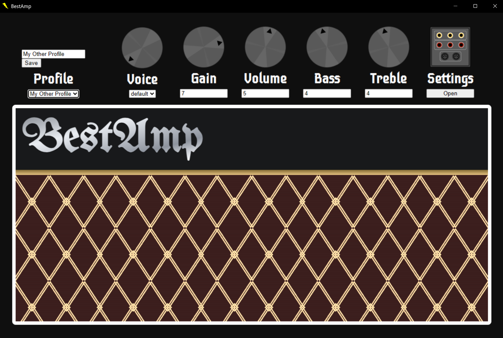
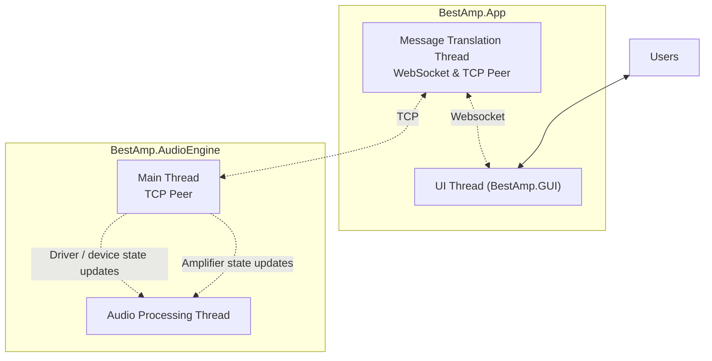

# BestAmp

A software guitar amplifier for Windows.

By Will and Rodrigo of BCIT.




## BestAmp Components

Some brief notes about the role(s) of each component.
- BestAmp.App
    - A .NET windows executable
    - Orchestrates BestAmp components
        - Acquires a WinForms window
        - Loads the `BestAmp.GUI` into the window's WebView2 component
        - Spawns the `BestAmp.AudioEngine` & connects to it via TCP
    - Message translation
        - websocket -> tcp
        - tcp -> websocket
- BestAmp.AudioEngine
    - A windows executable
    - Implemented using PortAudio
    - Capabilities of the amplifier
        - Gain, Power, Bass, Treble
        - with dB ranges for the inputs varied by amplifier Voices
    - Drivers/Device
        - driver and device selection
        - input device
        - output device
        - channel count
        - sample rate
    - Amplifier / guitar settings configurable via TCP messages
- BestAmp.GUI
    - The graphical user interface
    - Built w/ web technologies because they are simply the best tools for GUI



## Building the Project

Required software:
- msys2 toolchain, ucrt64 recommended
    - add `C:\msys64\usr\bin` to PATH
        - GNU userland exes
        - used in the makefile
    - add `C:\msys64\ucrt64\bin` to PATH
        - `gcc`, `make`
- .NET 10
    - Windows
    - ASP.NET
- Python3
    - testing

> [!WARNING]
> **PowerShell** aliases will cause some cmdlets to execute over GNU exes, this may or may not be an issue, usually it isn't.


### Build & Run
Compile the projects
```pwsh
make
```
Assembles the AudioEngine & GUI build artifacts in the `bin/Release/..` of `BestAmp.App` & starts the application.

### Build & Run for Debugging
Or compile the App, AudioEngine w/ debug symbols.
```pwsh
make debug
```
Instead of assembling the AudioEngine & GUI build artifacts under `bin/Release/..`, `bin/Debug/..`.


### Prepare a Distributable Version
Compiles the applications & assembles them under a `dist` directory.
```pwsh
make publish
```

## Documentation
Documentation is organized under the [`docs`](./docs) directory. This includes diagrams & written documentation. We use mermaid for diagrams & md for documentation.

There's also more info is available in each of the component READMEs, specifically information pertaining to the development of whichever component, so that may be less relevant depending on your reason for being in this repo.
