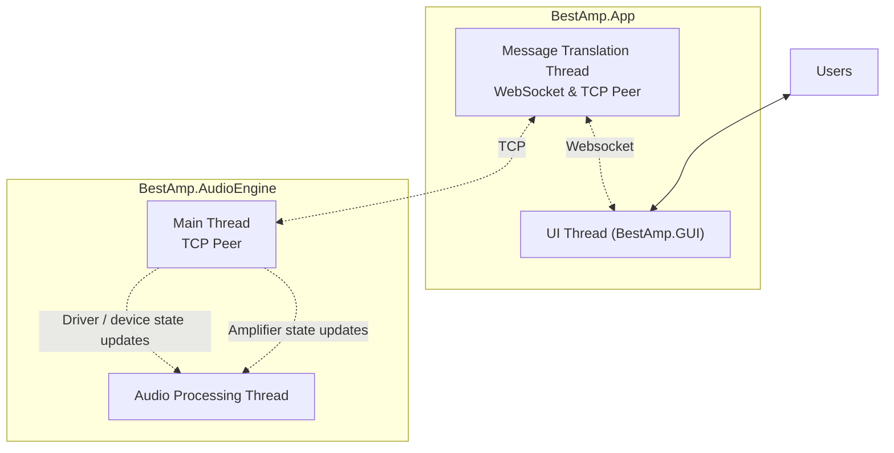
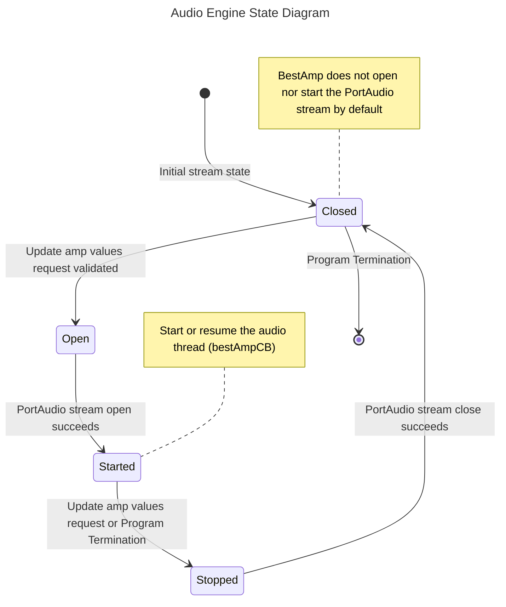
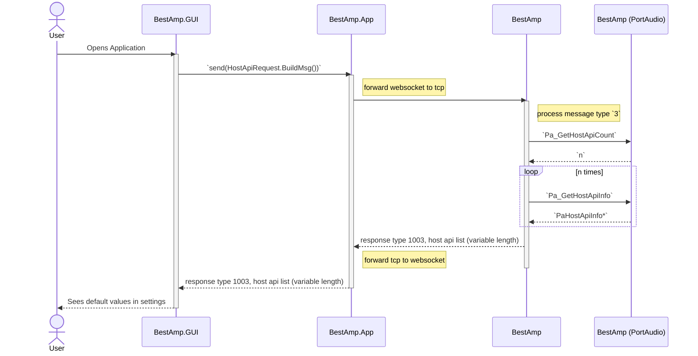
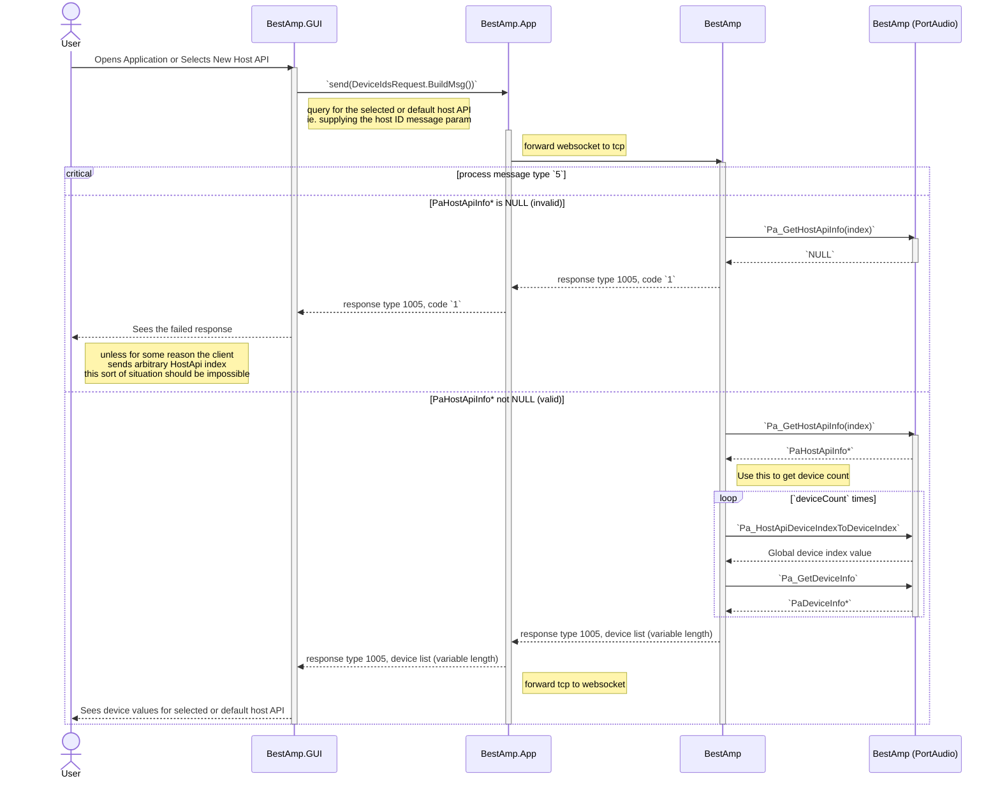
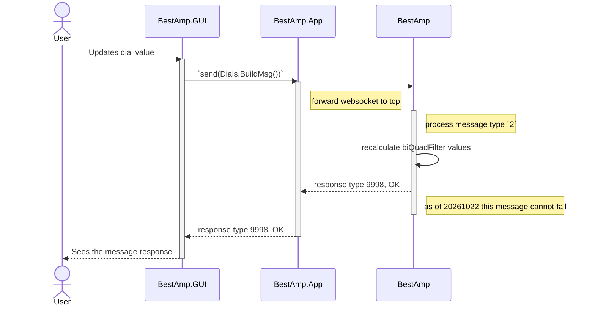
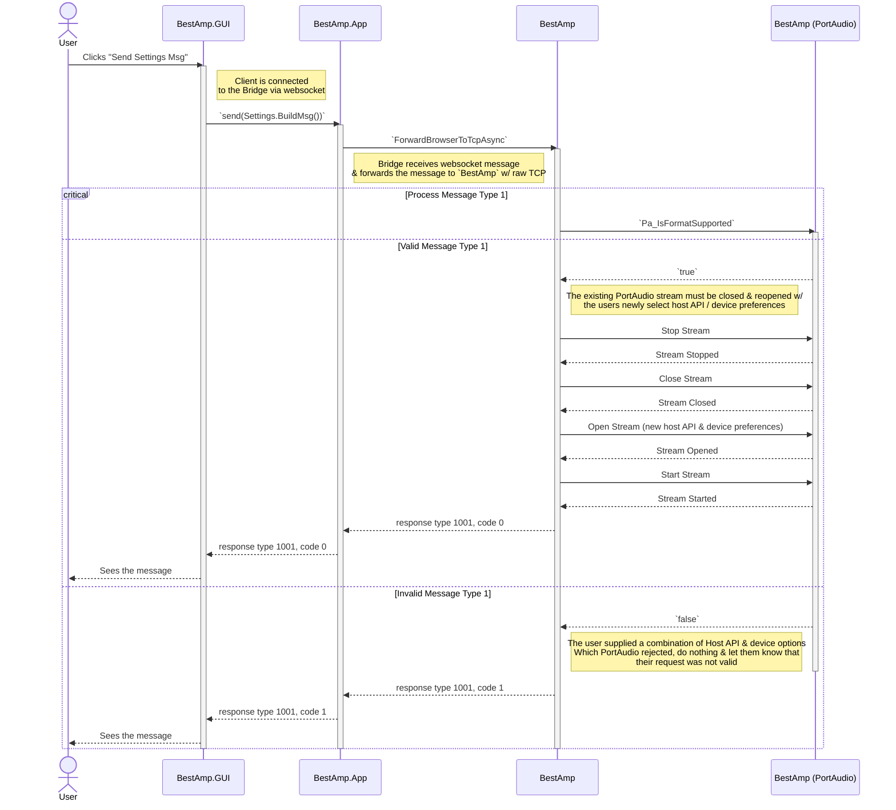
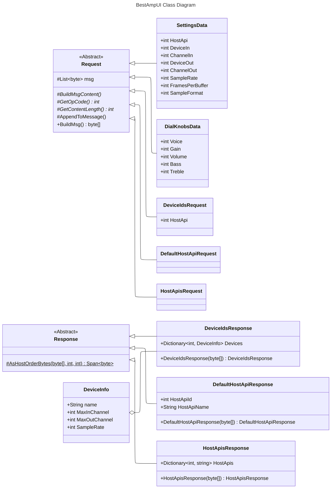

# BestAmp
### High Level Design

## Goals for BestAmp
BestAmp is to be a software guitar amplifier, one that should be simple to use compared to the sometimes cumbersome existing amplifier softwares.

Unlike other software, which attempts to be all things to all people, BestAmp will be the most stripped down version of an amplifier giving users the following inputs: Pre-amplification (henceforth referred to as Gain), Power-amplification (henceforth referred to as Volume) as well as the two most common EQ inputs Bass & Treble.

In addition to the amplifier inputs, the user will also be able to select the drivers and input / output device settings for said drivers, in order to take full advantage of whatever interface.

BestAmp will target Windows only, we are not experienced enough with cross-compilation nor do we think we have enough time to attempt a cross-platform release during the semester.

## Architecture
BestAmp will be implemented as two separate programs:
- An AudioEngine "backend" Application
- A Client "frontend" Application

The AudioEngine application is implemented in C using PortAudio. We chose this approach for the AudioEngine because the signal processing must be done with the lowest latency possible, & we can eliminate the overhead of a runtime/JIT by having the AudioEngine be a native binary. The PortAudio library allows BestAmp to support the broadest surface of operating systems, drivers and therefore devices (even though our target OS is only Windows, we want to support drivers & devices).

The Client application is implemented with Web technology (Blazor WASM), with the App serving the GUI using Windows Forms with WebView2 to give a native appearance. Our decision to write the GUI with Web technology comes down to the development team's preference for Web technology w.r.t. GUIs (it's also the easiest technology to create GUIs with), the alternative would be to implement the GUI also in C using Win32 APIs, but those APIs are cumbersome (to say the least). Serving the GUI with WebView2 on windows will let BestAmp provide it's users with a native feeling experience in the UI, while also allowing the project to remain feasible.

### AudioEngine State

The Client will control the AudioEngine, which will exist in different states according to the following diagram:

### Message Definitions

In order for the Client application to control the AudioEngine, a standard for communication messages is defined in the [BestAmp Protocol Specification](./ba_proto_spec.md). This document dictates the byte-structure of messages & the semantics of communication: the messages the AudioEngine will accept as requests & the messages it will emit as replies.

For each of the protocol messages, the Client application and AudioEngine will interact according to the following diagrams:

**Query Host APIs**

**Query Devices**

**Update Amp Values**

**Update Preferences**

### Client Application Class Hierarchy

The Client application will organize it's state according to the following class hierarchy:

